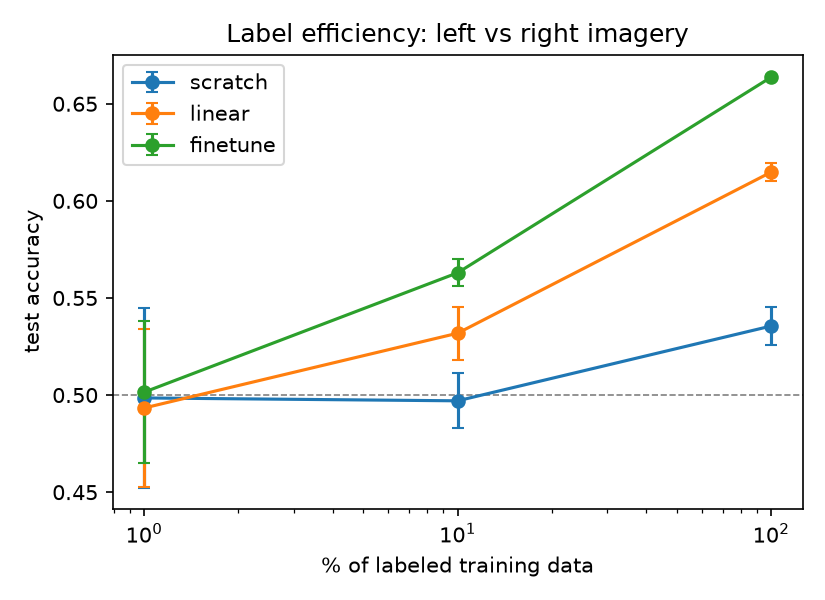

# EEG-MAE: Masked Autoencoder Pretraining for EEG

Self-supervised transformer pretraining (masked patch reconstruction) on EEG,
evaluated on cross-subject left-vs-right motor imagery with PhysioNet EEGMMIDB.

## Method
- **Data:** PhysioNet EEG Motor Movement/Imagery, runs 4, 8, 12 (imagery of left/right fist), 64 channels, 160 Hz. Band-pass 0.5-40 Hz, 2 s windows, per-channel z-score.
- **Split (by subject, no leakage):** subjects 1-30 for pretraining and training, subjects 31-40 held out for testing.
- **Tokens:** each window is split into 64 channels x 8 time patches (40 samples) = 512 tokens, with learned channel and time embeddings.
- **Pretraining:** MAE-style. 75% of tokens masked, a 4-layer transformer encoder (dim 128) sees the other 25%, a 2-layer decoder reconstructs masked patches. Loss is MSE on masked patches only. 0.92M parameters. 11,016 unlabeled windows, 30 epochs, AdamW with warmup + cosine schedule.
- **Downstream:** mean-pooled encoder features -> linear head.
  - `scratch`: random init, trained end to end
  - `linear`: frozen pretrained encoder, linear head only
  - `finetune`: pretrained encoder, trained end to end
  Each run uses a fixed 200 steps and is evaluated once on the held-out subjects (no model selection on test data). Label fractions 1%, 10%, 100%, 3 seeds each.

## Results
Pretraining reconstruction loss (val, masked patches): 0.895 -> 0.194 (`results/pretrain_log.csv`).

Test accuracy on held-out subjects 31-40 (mean +- std over 3 seeds; chance = 0.5):

| labels | scratch | linear probe | finetune |
|---|---|---|---|
| 1% (~14 trials) | 0.499 +- 0.046 | 0.493 +- 0.041 | 0.501 +- 0.036 |
| 10% (~135 trials) | 0.497 +- 0.014 | 0.532 +- 0.014 | 0.563 +- 0.007 |
| 100% (1,350 trials) | 0.536 +- 0.010 | 0.615 +- 0.005 | 0.664 +- 0.001 |



## Takeaways
- With full labels, pretraining improves cross-subject accuracy substantially (finetune +13 points over scratch; frozen-encoder linear probe +8).
- At 10% labels, finetuning still helps (+6 points), but the effect is smaller.
- At 1% labels (14 trials) all methods are at chance, so pretraining at this scale does not remove the need for labels.

## Limitations
- Small model and small pretraining set (30 subjects, one task family).
- 3 seeds and a single held-out subject split; no confidence intervals beyond seed std.
- Absolute accuracy is modest, as expected for cross-subject motor imagery.
- Scratch baseline uses the same fixed budget as finetune and was not separately tuned.

## Reproduce
```bash
pip install -r requirements.txt
pytest -q
python pretrain.py --epochs 30
python finetune.py --ckpt checkpoints/mae.pt
```
Unit tests cover mask ratio, kept/masked token consistency, masked-only loss, and gradient flow.
